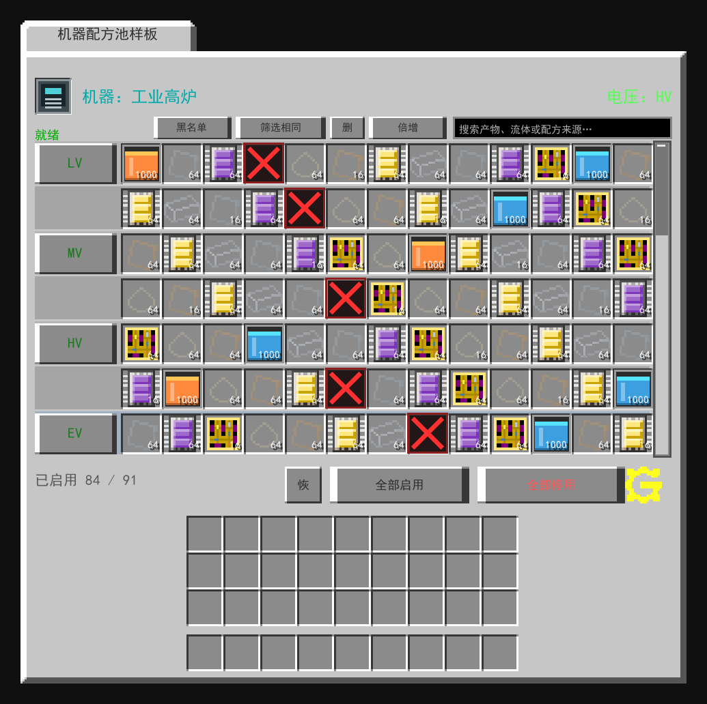

# Void Fabricator

**English** | **[简体中文](#简体中文)**

A standalone GTNH 1.7.10 addon that publishes GregTech machine recipes as **native AE virtual processing patterns**. Players see and order them in a normal AE crafting terminal; a normal AE `CraftingCPUCluster` pulls the inputs and executes the job. The block is only an `ICraftingProvider` / `ICraftingMedium`; there is no private CPU, no custom recursive planner, and no second input charge at execution time.

- Current version: `0.3.7-alpha`
- Repository: <https://github.com/wztwztss/VoidFabricator>
- Previous Release: <https://github.com/wztwztss/VoidFabricator/releases/tag/v0.3.1-alpha> (`0.3.2-alpha` / `0.3.3-alpha` / `0.3.4-alpha` / `0.3.5-alpha` / `0.3.6-alpha` / `0.3.7-alpha` not published yet)
- Build artifact: `174,850` bytes, SHA-256 `4CA1E30D4AD8B47A4C2CCC22BBD72A984C054E537FD53E3E999D3E6FF395D984`



*Static layout preview rendered from the current code, not an in-game screenshot.*

## English

### Current design contract

**The Void Fabricator block contains 27 physical pattern slots in a 9×3 grid. Each physical pattern holds one GT machine and owns its complete recipe-pool configuration UI.**

- The 27 slots are 27 physical pattern items, not 27 machine pools hidden inside a single pattern.
- Each pattern stores one machine, the full scan of that machine's recipes, the complete entry set, per-entry enabled state, black/white lists, deleted keys, and smart-doubling settings.
- Right-click a pattern item to open its own UI. Sneak-right-click the block to insert the pattern into the first empty physical slot.
- If multiple patterns produce the same `RecipeKey`, it is published to AE only once and all source patterns are tracked.
- Normal AE terminals are the ordering surface. Ordering from inside the Void Fabricator block is neither supported nor intended.

```text
TileVoidFabricator: 27 physical pattern slots
  ├─ Pattern 0: one machine + full entries + own filters/doubling
  ├─ Pattern 1: one machine + full entries + own filters/doubling
  └─ ...
        ↓ scan each slot, filter, deduplicate by RecipeKey, keep sources
ICraftingProvider publishes VirtualPatternDetails
        ↓
normal AE crafting terminal: visible and orderable
        ↓
normal CraftingCPUCluster extracts inputs
        ↓
TileVoidFabricator.pushPattern verifies the block owner's wireless EU, consumes only inputs already delivered by AE
        ↓
OutputBuffer reserves N output batches and re-injects them into AE
```

### Block UI

220×286 MUI2 panel:

- The header shows AE online state, published count, in-flight batches, and wireless-EU rejection status.
- The center is a 9×3 physical pattern grid supporting normal insertion, extraction, and Shift-click.
- There is no separate GT machine slot, single pattern slot, or bulk-extract button.
- Right-clicking the block with a GT machine in hand tells the player to put the machine into the pattern's own UI.

### Pattern item UI

Right-click the `Machine Recipe Pool Pattern` to open a **325×309 standard GT panel** using `GTGuiThemes.STANDARD`, the same size and theme family as the TenkeiTech template input bus.

#### One machine and the complete recipe pool

- The top has exactly one machine slot. It accepts one GT machine and mirrors the configuration back to the current main-hand stack immediately and again on close.
- It scans the machine's complete valid recipe set; the “27 total patterns” idea does not cap the recipe pool.
- 13×7 is only the visible window (91 icons); it is not a recipe-count limit.
- Search matches the main output name, display name, and source case-insensitively; it never deletes unmatched recipes.
- Layout follows the TenkeiTech template input bus: 325×309 panel, 311-pixel content width, 13 icons of 20×20 per row, 22-pixel row height, list at y=38, 40-pixel voltage label on the left, search field at x=204, vertical slider at x=302, bottom count/restore/enable-all/disable-all/GT logo, then the standard player inventory.
- Search, black/white mode, same-output grouping, deletion, restore, and doubling are compressed into one top row so the 7×13 list stays intact.

#### Row scrolling and voltage rows

- A 13-column × 7-row icon window with a vertical slider; the mouse wheel moves one row, and the empty list area, icons, and slider behave consistently.
- The 40-pixel voltage label is also a whole-tier enable/disable button; clicking it toggles every recipe displayed in that voltage tier.
- Client scrolling requests a server-side window through a C2S value. The server clamps the first row and sends back at most 91 visible entries, instead of shipping thousands of recipes to the client.
- Search, deletion, and rescans clamp the first row again. A server-side click index resolves back to the original recipe even after filtering.

#### Recipe actions and one-row-per-output grouping

- Left-click enables/disables or restores one entry. A user-disabled entry gets a dark overlay, red border, and red cross, distinct from the neutral dim used by black/white-list filtering.
- Right-click the main-output cell to toggle that output in the black/white list. The list affects display and publication only; it never deletes recipes.
- **The “Group Same Output” toggle switches to one row per main output**: one output occupies one row, and the 13 columns show the alternatives that produce it. One output is one row; two outputs are two rows. Clicking a cell disables/restores only that alternative, so the player can cancel candidates one by one and keep the desired one. The row label shows row number, output name, and the full group count.
- If a group has more than 13 alternatives, only the first 13 are visible in the current row; the full count remains in the row label. In-row horizontal paging is not implemented yet.
- “Delete Selected” removes by `RecipeKey` and a rescan does not restore it; “Restore Deleted” clears deleted keys and rescans.
- “Enable All / Disable All” affects the complete recipe pool of the pattern, not only the visible window.
- Black/white list, removed filter tags, cleared lists, cleared search, smart doubling, same-output grouping, and max rounds are all stored per pattern and written to its NBT.

#### NEI R / P lookups

- Hovering a virtual recipe cell and pressing `R` asks NEI `GuiCraftingRecipe` for the real GT recipe (item or fluid).
- `P` uses a custom `void_pattern` usage handler with `GuiUsageRecipe` to show the visible entry's inputs/outputs, EU/t, duration, and source. Inputs and outputs use `PositionedStack` / `FluidStack` directly; fluids are not downgraded to bucket items.
- The shortcut handler only responds on ModularUI screens with a hovered cell, avoiding repeated triggering on NEI pages.

### Fluid display

- Item outputs render their item icon.
- Fluid outputs preserve and sync a real `FluidStack` and render the actual fluid texture; no bucket icon is created.
- The icon shows the original fluid amount, and the tooltip only shows the name and amount/mB.

### AE-native execution

- `ICraftingProvider` publishes all deduplicated processing patterns to a normal AE network.
- Uses a normal AE crafting CPU; no private CPU and no custom recursive planner.
- `pushPattern` checks the inputs already delivered by AE, checks/debits the owner's wireless EU, consumes the inputs on success, and registers the outputs. On failure it does not mutate inputs and does not leave a partial energy debit.
- It does not pull a second time from ME during execution.
- Undelivered item/fluid outputs go into a bounded, persistent `OutputBuffer`, which survives disconnects and retries after reconnect.

### Smart doubling (optional AE2-QoL)

- When `ae2_qof` is present, an optional `ISmartDoublingMedium` bridge reuses AE2-QoL's normal CPU Mixin.
- Maximum rounds: 0 auto / 1 / 2 / 4 / 8 / 16 / 32 / 64; hard cap 256.
- The multiplier is also bounded by remaining output-buffer batches, stack-type capacity, and the pattern configuration.
- If any source pattern for a duplicate recipe disables smart doubling, that recipe's multiplier is limited to 1.
- If every source enables it, the strictest round limit among sources wins, preventing bypass of one pattern's configuration.
- Without AE2-QoL, it falls back to a normal one-round Medium; the configuration remains stored.

### Wireless EU power

- Accepted crafts debit the **block owner's GregTech wireless EU map**, the same pool used by GT wireless output/input hatches, through `WirelessNetworkManager`.
- The block owner is bound when the block is placed. An existing block without `OwnerUUID` binds the first player who opens it; later players do not silently re-bind it.
- The owner must be the block owner, not the pattern item owner. In a team, GT resolves the charge through the team leader, so the team pool is shared.
- Before consuming AE inputs, `pushPattern` checks the owner's `getUserEU` balance and then performs one atomic debit with `addEUToGlobalEnergyMap(owner, -cost)`; insufficient balance is rejected without a partial charge.
- Cost is `recipe EU/t × duration (ticks) × requested batches`. Zero or negative EU/t costs zero, so those recipes do not require an owner.
- If the output buffer rejects the craft after the debit, the charge is refunded and the status becomes `buffer_error`.
- The block GUI reports `no_owner` or `insufficient_power`; this is status text only, not a chat notification.
- GT overclocking is treated as total-EU-neutral (4× EU/t for 1/4 duration). Machine tier, parallel processing, and sub-tick imperfect-overclock edge cases are not separately modeled; the calculation uses the stored `RecipeSnapshot` base EU/t and duration.

### Usage

1. Right-click the pattern item to open its own UI.
2. Put one GT machine into the top machine slot and wait for the recipe scan.
3. Search, scroll row by row, or drag the slider through the complete pool; enable “Group Same Output” when needed.
4. Left-click to exclude/restore, right-click to edit the black/white list, cancel same-output alternatives, or delete recipes; press R/P while hovering for NEI.
5. Configure smart doubling and max rounds as needed.
6. Close the item UI. The pattern stays in the main-hand slot and its configuration is written back to NBT.
7. Sneak-right-click the Void Fabricator to install the pattern; up to 27 physical patterns are supported.
8. Order normally in a standard AE crafting terminal and execute with a standard AE CPU; make sure the block owner has enough EU in the GT wireless grid.

### NBT and migration

#### Block

- Main structure is `Patterns`; each entry has a `Slot` number.
- Legacy `PoolPattern` and `Machine` read/migration paths are retained.
- The first compatible pattern can receive the legacy machine. A legacy machine without a pattern is stored in `legacyMachine` and still drops on break.

#### Pattern

- `ConfigFormat=4`; runtime has exactly one `RecipePoolSlot`, and `Pools` writes only the primary pool.
- `MAX_POOLS=27` exists only for reading old formats and old view compatibility; it does not mean 27 runtime pools.
- Both the old single-pool root node and old `Pools` are migratable.
- The retired “one pattern with 27 machines” format keeps a raw `LegacyPools` backup, selects a primary machine, rescans, and only restores enabled state for identical `RecipeKey`s.
- This old 27-pool migration is **lossy**: the other machines are not automatically converted into new physical patterns. Do not claim a lossless 27-machine conversion.

### Current limitations and unverified items

- “Group Same Output” matches by main output: item `registryName + damage` or fluid name, ignoring item NBT. It is not a complete RecipeKey, recipe type, or voltage-tier match.
- A same-output row shows at most 13 alternatives; above 13, the row label shows the full group size but the window only shows the first 13. In-row horizontal paging is not implemented.
- Identical `RecipeKey`s are deduplicated in AE and do not appear as multiple terminal entries.
- Scans still skip null/disabled/fake entries, non-100% probability recipes, alternate fluid inputs, unconvertible special items, zero-real-input recipes, recipes without outputs, and duplicate recipes.
- Pattern right-click instant-close: the `settings.canInteractWith` check was removed and writes now mirror the current main-hand slot; there is no new in-game evidence that the close path is fully closed.
- The instance log message `Hollow rectangles currently can't have a corner radius` was handled by removing the hollow-corner-radius combination, avoiding client/server log spam.
- The block and pattern are currently obtained from the creative inventory; there are no crafting recipes.
- The old three-tab `PatternEditorPanel` / `PatternEditorGui` remain as unused dead code and are not current entry points.
- The old `docs/ui-preview-pattern-pools.png` and `docs/ui-preview-pattern-browser.png` belong to the rejected 27-pool two-page design and do not represent the current UI. The current static layout preview is `docs/ui-preview-pattern-ui-325x309.png`, generated by `tools/RenderPatternUi.java`; it is a layout preview, not an in-game screenshot.
- GTNH in-game verification is performed by the user. The assistant did not start the game and does not treat a successful compile as an in-game pass.
- Wireless EU cost uses the stored base `RecipeSnapshot` EU/t and duration. GT overclock/parallel/tier effects and sub-tick imperfect overclock are not re-simulated; perfect overclock is assumed to keep total EU unchanged.
- A legacy block with no `OwnerUUID` is rejected with `no_owner` if AE schedules it before any player opens it; opening the block once binds the current player and resolves this.
- Insufficient EU is visible in the block GUI status only; no chat message or terminal-side balance display is implemented.

### Build and validation

Java 17 and Gradle:

```powershell
# Set JAVA_HOME to a Java 17 JDK, then:
.\gradlew.bat spotlessApply build --offline
python tools/check_lang.py
python tools/validate_assets.py
```

Third-party compile-time jars are not committed. Put the exact files listed in [`libs/README.md`](libs/README.md) into `libs/` first. The released jar does not require this directory.

Static results for this build:

- `spotlessCheck`: passed
- `checkstyleMain`: passed
- `jar` / `reobfJar` / `build`: passed
- `test`: `NO-SOURCE`
- Chinese/English language keys: 264 each, no duplicates or set differences
- Java direct text references: 95, no missing keys in either language
- Tooltips: 32/32 in both languages
- Textures, tooltips, and jar resources: `ASSET_VALIDATION=PASS`
- Current artifact: `160,882` bytes, SHA-256 `4E8AFB054CE935E096AC9F969CF3961360526F7EFFE719EFC857C7DFC4F66405`
- GTNH in-game verification: not performed; owned by the user

The final artifact and instance hash are also recorded in [`docs/AGENT_HANDOFF_MEMORY.md`](docs/AGENT_HANDOFF_MEMORY.md).

### Main source map

```text
pattern/RecipePoolSlot.java        one machine, full scan, entries and NBT
pattern/PatternPoolData.java       primary pool, filters/deletion, search, row window, format-4 migration
pattern/PatternView.java           pool summary + up to 91 visible entries + same-output groups, format 4
pattern/PatternGroupView.java      one row per main output and its alternatives
pattern/PatternEntry.java          recipe entry, real FluidStack, globalIndex, EU/t tier
item/ItemMachineRecipePoolPattern.java  physical pattern item, right-click entry, tooltip
gui/PatternItemPanel.java          325×309 GT standard panel, 13×7 single-machine pool UI
gui/PatternGuiSession.java         search, first-row offset, slider, server-side entry actions
gui/PatternItemGui.java            main-hand item entry, current-hand NBT mirror write-back
gui/PatternMachineHandler.java     the pattern's single machine slot
gui/VoidFabricatorGui.java         220×286 block status and 9×3 physical pattern slots
block/BlockVoidFabricator.java    block registration, placement owner binding, protection
tile/TileVoidFabricator.java       27-slot NBT, owner binding, wireless EU charge, publication aggregation, Provider/Medium
energy/WirelessGridEnergy.java     GT wireless EU cost, balance, atomic debit, refund and user initialization
recipe/                            GT scan, RecipeSnapshot, RecipeKey
ae/                                output buffer and optional AE2-QoL bridge
client/                            NEI R/P bridge and custom void_pattern usage page
```

Detailed design and review:

- [`docs/DESIGN_void_fabricator.md`](docs/DESIGN_void_fabricator.md)
- [`docs/DESIGN_pattern_configuration_center.md`](docs/DESIGN_pattern_configuration_center.md)
- [`docs/REVIEW_pattern_configuration_center.md`](docs/REVIEW_pattern_configuration_center.md)
- [`docs/AGENT_HANDOFF_MEMORY.md`](docs/AGENT_HANDOFF_MEMORY.md)

### In-game test checklist

1. Does normal right-click on the pattern still close instantly? After inserting a machine, does close/reopen preserve it? After extracting an existing machine, does close/reopen stop showing it?
2. Search, row scrolling, slider, and the 13×7 window; do clicks, filters, and deletions hit the correct recipe outside the first row?
3. Item/fluid icons, true fluid textures and amounts, disabled dimming, black/white restoration, and enable/disable all.
4. The 27 block slots: insert, extract, Shift-click, save/restart, break drops, and legacy-machine migration.
5. Normal AE terminal: all patterns visible, duplicate recipes appearing once, and normal ordering.
6. Normal CPU execution: exactly one input charge, correct output re-injection, and correct behavior when disconnected or when the buffer is full.
7. With duplicate sources, one source disabling doubling must suppress doubling; different round limits must resolve to the strictest value.
8. Old single-pool patterns, old 27-pool patterns, and `LegacyPools` backup migration.
9. The 325×309 panel at 1080p, 1440p, and different GUI scales; check that the player inventory is not clipped.

---

## 简体中文

独立的 GTNH 1.7.10 模组：将 GregTech 机器配方发布为 **AE 原生虚拟处理样板**。玩家在普通 AE 合成终端看到并下单，由普通 Crafting CPU 抽料和执行；方块只承担 Provider/Medium，不提供私有 CPU，也不在执行时二次扣料。

当前版本：`0.3.7-alpha`。

仓库：<https://github.com/wztwztss/VoidFabricator>  
上一个 Release：<https://github.com/wztwztss/VoidFabricator/releases/tag/v0.3.1-alpha>（`0.3.2-alpha` / `0.3.3-alpha` / `0.3.4-alpha` / `0.3.5-alpha` / `0.3.6-alpha` / `0.3.7-alpha` 尚未发布）  
构建产物：`174,850` 字节，SHA-256 `4CA1E30D4AD8B47A4C2CCC22BBD72A984C054E537FD53E3E999D3E6FF395D984`

### 当前核心语义

**虚空合成机方块内有 9×3 共 27 个实体样板槽；每张样板只放一台 GT 机器，并拥有自己的完整配方池配置 UI。**

- 27 格是 27 张实体样板，不是一张样板内部的 27 个机器池。
- 每张样板保存一台机器、该机器的扫描结果、完整条目集合、启停、黑白名单、删除记录和智能倍增设置。
- 手持样板普通右键打开独立 UI；潜行右键方块把样板放入第一个空槽。
- 多张样板出现相同 `RecipeKey` 时只向 AE 发布一次，并记录所有来源样板。
- 普通 AE 终端是下单入口；无需也不应在虚空合成机方块内下单。

```text
TileVoidFabricator：27 个实体样板槽
  ├─ 样板 0：一台机器 + 完整 Entries + 独立筛选/倍增
  ├─ 样板 1：一台机器 + 完整 Entries + 独立筛选/倍增
  └─ …
        ↓ 逐槽扫描、筛选、按 RecipeKey 去重并记录来源
ICraftingProvider 发布 VirtualPatternDetails
        ↓
普通 AE 合成终端正常可见、正常下单
        ↓
普通 CraftingCPUCluster 抽取输入
        ↓
TileVoidFabricator.pushPattern 校验方块主人的无线 EU、只消费 AE 已交付输入
        ↓
OutputBuffer 预留下 N 批输出并回注 AE
```

### 方块 UI

220×286 MUI2 面板：

- 顶部显示 AE 在线状态、已发布数量、在途批次和无线 EU 拒绝状态。
- 中部为 9×3 实体样板格，支持正常放入、取出和 Shift 点击。
- 不再有独立 GT 机器槽、单总样板槽或整组取出按钮。
- 手持 GT 机器右键方块时提示先把机器放入样板自己的 UI。

### 样板物品 UI

手持 `机器配方池样板` 普通右键打开 **325×309 标准 GT 机壳面板**（`GTGuiThemes.STANDARD`，与 TenkeiTech 模板输入总线同尺寸、同主题）。

#### 单机器与完整配方池

- 顶部只有一个机器槽，严格放入一台 GT 机器；机器写入后立即镜像回当前主手槽，关闭 UI 再写一次。
- 扫描该机器的完整有效配方集合，不受“全样板总共 27 条”的限制。
- 13×7 只是可见窗口（91 个图标），不是配方数量上限。
- 搜索按主输出名、显示名和来源进行不区分大小写匹配；搜索不会删除未匹配配方。
- 布局按 TenkeiTech 模板输入总线：325×309、内容宽 311、每行 13 个 20×20 图标、行高 22、列表 y=38、左侧 40 px 电压标签、搜索框 x=204、右侧滑块 x=302、底部计数/恢复/全部启用/全部停用/GT logo 和玩家背包。
- 搜索、黑白名单、筛选相同、删除、恢复和倍增被压缩到顶部同一行，避免破坏 7 行 13 列主列表。

#### 逐行滚动

- 13 列 × 7 行图标窗口，右侧纵向滑块；滚轮每次移动一行，列表空白、图标和滑块上的滚轮行为一致。
- 左侧 40 px 电压标签同时是整层启停按钮；点击切换该电压层全部配方。
- 客户端滚动会通过 C2S 同步请求服务端窗口，服务端重算首行后回发当前最多 91 个可见条目，不把上千条配方一次性发给客户端。
- 搜索、删除或重扫后重新钳制首行；服务端点击索引会还原到搜索前的原配方。

#### 配方操作与同产物分组

- 左键启停/恢复单条；用户禁用和黑白名单过滤都显示暗色蒙层、红色边框和大红叉。
- 右键主管道格切换该主输出的黑白名单；黑白名单只影响显示和发布，不删除配方。
- **“筛选相同”开关开启同产物分组视图**：同一主输出只占一行，行内 13 列按顺序列出该产物的配方备选；只有该产物有两条及以上配方时才占行，单条产物不单独成行。点击某格只禁用/恢复该条配方，玩家可以逐条取消，保留想留的那一条；行首显示行号、产物名和该组总数。
- 同组超过 13 个备选时只显示前 13 个，行首总数仍显示完整组大小；后续可以再扩展行内横向浏览。
- “删除选中”按 `RecipeKey` 删除，重扫不补回；“恢复删除”清空删除记录并重扫。
- “全部启用 / 全部停用”作用于当前样板的完整配方池，不只是可见窗口。
- 黑名单/白名单、筛选标签移除、清空名单、清空搜索、智能倍增、同产物分组和最大轮数均属于当前样板，并写入样板 NBT。

#### NEI R / P 查询

- 鼠标悬停虚拟配方格时，`R` 用 NEI `GuiCraftingRecipe` 查询真实 GT 配方（物品或流体）。
- `P` 使用 `GuiUsageRecipe` 的自定义 `void_pattern` usage handler，打开当前可见条目的输入/输出、EU/t、持续时间和来源；输入/输出直接使用 `PositionedStack`/`FluidStack`，不把流体退化成桶。
- 快捷键只在 ModularUI 屏幕且有悬停格时响应，避免在 NEI 页面重复触发。

### 流体显示

- 物品主输出显示物品图标。
- 流体主输出保存并同步真实 `FluidStack`，直接渲染流体纹理，不创建桶图标。
- 图标叠加原始流体数量，Tooltip 只显示名称和数量/mB。

### AE 原生执行

- `ICraftingProvider` 向普通 AE 网络发布全部去重后的处理样板。
- 使用普通 AE Crafting CPU，不注册私有 CPU，不自研递归规划器。
- `pushPattern` 逐槽验证 AE 已交付输入，校验并扣除方块主人的无线 EU，成功后消费这些输入并登记输出；失败不修改输入，也不留下半笔扣电。
- 不在执行时再次从 ME 扣料。
- 未交付物品/流体进入有界、持久化 `OutputBuffer`，断网保留并重连重试。

### 智能倍增（可选 AE2-QoL）

- 检测到 `ae2_qof` 时，通过 `ISmartDoublingMedium` 可选桥接复用 AE2-QoL 的普通 CPU Mixin。
- 最大轮数：0 自动 / 1 / 2 / 4 / 8 / 16 / 32 / 64；硬上限 256。
- 倍数同时受输出缓冲剩余批次、堆栈类型容量和样板配置限制。
- 重复配方的任一来源样板关闭智能倍增时，该配方倍率限制为 1。
- 所有来源均开启时，采用来源中最严格的轮数限制，防止绕过某张样板的配置。
- 未安装 AE2-QoL 时回退普通单轮 Medium，配置仍保留。

### 无线 EU 供电

- 被 AE 接受的合成会通过 `WirelessNetworkManager` 从**方块主人的 GregTech 无线 EU 池**扣电；该池与 GT 无线输出仓/输入仓使用的是同一个玩家/团队池。
- 方块放置时绑定主人；已存在但没有 `OwnerUUID` 的旧方块由第一个打开它的玩家绑定，之后不会静默改绑给其他人。
- 扣电对象是方块主人，不是样板物品主人。玩家在团队中时，GT 按团队 leader 结算，因此使用团队共享池。
- 在消费 AE 输入前，`pushPattern` 先读取主人的 `getUserEU` 余额，再通过 `addEUToGlobalEnergyMap(owner, -cost)` 做一次原子扣电；余额不足直接拒绝，不会部分扣电。
- 扣电金额为“配方 EU/t × 工作时长（tick）× 本次工作份数”。EU/t 为零或负时按 0 计，因此这类配方不要求绑定主人。
- 扣电后若输出缓冲拒绝该批产物，会退回本次扣电，并把状态置为 `buffer_error`。
- 方块 GUI 会显示 `no_owner` 或 `insufficient_power`；目前只有状态文案，没有聊天栏提示。
- GT 超频按“总 EU 基本不变”处理（4 倍功率、1/4 时长）；机器 tier、并行和低于 1 tick 的不完美超频边界没有单独模拟，计算使用样板中保存的 `RecipeSnapshot` 基础 EU/t 与时长。

### 操作方式

1. 手持样板普通右键，打开样板自己的 UI。
2. 在顶部机器槽放入一台 GT 机器，等待配方扫描。
3. 搜索、逐行滚动或拖动滑块查看完整配方池；按需开启“筛选相同”查看同产物行。
4. 按需左键排除/恢复、右键加入黑白名单、逐条取消同产物备选或删除配方；悬停时 R/P 查询 NEI。
5. 按需开启智能倍增和最大轮数。
6. 关闭物品 UI；样板保留在原主手槽，配置写回其 NBT。
7. 潜行右键虚空合成机安装样板，最多安装 27 张。
8. 在普通 AE 合成终端正常下单，使用普通 AE CPU 执行；确认方块主人在 GT 无线电网中有足够 EU。

### NBT 与迁移

#### 方块

- 主结构为 `Patterns`，每项含槽号 `Slot`。
- 保留 `PoolPattern` 和 `Machine` 的旧读取/迁移入口。
- 首个兼容样板可接收旧机器；暂时没有样板的旧机器保存在 `legacyMachine`，拆除仍掉落。

#### 样板

- `ConfigFormat=4`，运行态只有一个 `RecipePoolSlot`，保存时 `Pools` 只写主池一项。
- `MAX_POOLS=27` 只用于旧格式读取和旧视图兼容，不代表运行态有 27 个池。
- 旧单池根节点和旧 `Pools` 均可迁移。
- 旧“一张样板 27 台机器”会保留 `LegacyPools` 原始备份，选择主机器并重扫，只恢复相同 RecipeKey 的启停状态。
- 该旧 27 池迁移是**有损迁移**：其余机器不会自动拆成新的实体样板，不能宣称 27 台机器配置无损转换。

### 当前限制与未闭环项

- “筛选相同”按主输出匹配：物品为 `registryName + damage`，流体为流体名，忽略物品 NBT；不是完整 RecipeKey、配方类型或电压等级。
- 同产物分组行最多显示 13 个备选；超过 13 个时行首总数为完整组大小，但当前窗口只显示前 13 个，尚未实现行内横向翻页。
- 相同 RecipeKey 在 AE 中去重发布，不会在终端显示为多份。
- 扫描仍跳过 null/禁用/fake、非 100% 概率、替代流体输入、无法转换的特殊物品、零真实输入、无输出和重复配方。
- 样板右键秒关：已移除 `settings.canInteractWith` 校验，并把配置写回改为当前主手槽镜像；尚无新实机结果证明关闭路径已闭环。
- 实例日志中的 `Hollow rectangles currently can't have a corner radius` 已通过移除空心圆角组合处理，避免客户端/服务端日志洪水。
- 方块和样板目前从创造模式物品栏获取，没有合成配方。
- 旧三页签 `PatternEditorPanel` / `PatternEditorGui` 保留为未使用死代码，不是当前入口。
- 旧 `docs/ui-preview-pattern-pools.png`、`docs/ui-preview-pattern-browser.png` 仍属于已否决的 27 池双页面，不代表当前 UI。当前静态布局预览为 `docs/ui-preview-pattern-ui-325x309.png`，由 `tools/RenderPatternUi.java` 生成；它是布局预览，不是游戏实机截图。
- GTNH 游戏内验证由用户执行；助手未启动游戏，不把编译成功当作实机通过。
- 无线 EU 扣电使用样板中保存的基础 `RecipeSnapshot` EU/t 与时长；GT 超频、并行和机器 tier 对每份耗电的影响，以及低于 1 tick 的不完美超频，没有重新模拟；完美超频按总 EU 不变处理。
- 旧方块没有 `OwnerUUID` 时，如果 AE 在任何玩家打开方块前就调度它，会以 `no_owner` 拒绝；打开一次方块绑定当前玩家后才会恢复。
- 电量不足目前只显示在方块 GUI 状态中，没有聊天栏提示，也没有终端侧余额显示。

### 构建与校验

使用 Java 17 和 Gradle：

```powershell
# 将 JAVA_HOME 指向 Java 17 JDK，然后：
.\gradlew.bat spotlessApply build --offline
python tools/check_lang.py
python tools/validate_assets.py
```

第三方编译期 jar 不提交到仓库；先按 [`libs/README.md`](libs/README.md) 将指定文件放入 `libs/`。只使用 Release jar 时不需要这些依赖。

本轮静态结果：

- `spotlessCheck`：通过
- `checkstyleMain`：通过
- `jar` / `reobfJar` / `build`：通过
- `test`：`NO-SOURCE`
- 中英文语言键：各 264，无重复、无集合差异
- Java 直接文案引用：95 个，双语均无缺失
- Tooltip：中英文各 32/32
- 纹理、Tooltip 和 jar 资源：`ASSET_VALIDATION=PASS`
- 当前构建产物：160,882 字节，SHA-256 `4E8AFB054CE935E096AC9F969CF3961360526F7EFFE719EFC857C7DFC4F66405`
- GTNH 游戏内验证：未执行，由用户负责

最终产物和实例哈希见 `docs/AGENT_HANDOFF_MEMORY.md`。

### 主要源码

```text
pattern/RecipePoolSlot.java       单台机器、完整扫描、条目与 NBT
pattern/PatternPoolData.java      单主池、筛选/删除、搜索、行窗口、格式 4 迁移
pattern/PatternView.java          单池摘要 + 当前最多 91 条可见窗口 + 同产物分组，格式 4
pattern/PatternGroupView.java     同一主输出一行及其备选
pattern/PatternEntry.java         配方条目、真实 FluidStack、globalIndex、EUt 电压档
item/ItemMachineRecipePoolPattern.java  实体样板物品、右键入口与 Tooltip
gui/PatternItemPanel.java         325×309 GT 标准机壳、13×7 单机器配方池 UI
gui/PatternGuiSession.java        搜索、首行偏移、滑块与服务端条目操作
gui/PatternItemGui.java           主手物品入口、当前手槽 NBT 镜像写回
gui/PatternMachineHandler.java    当前样板唯一机器槽
gui/VoidFabricatorGui.java        220×286 方块状态与 9×3 实体样板槽
block/BlockVoidFabricator.java    方块注册、放置绑定主人、保护
tile/TileVoidFabricator.java      27 槽 NBT、主人绑定、无线 EU 扣电、发布汇总、Provider/Medium
energy/WirelessGridEnergy.java    GT 无线 EU 计费、余额、原子扣电、退款与用户初始化
recipe/                           GT 扫描、RecipeSnapshot、RecipeKey
ae/                               输出缓冲与 AE2-QoL 可选桥接
client/                           NEI R/P 桥接与自定义 void_pattern 页面
```

详细设计与复核：

- `docs/DESIGN_void_fabricator.md`
- `docs/DESIGN_pattern_configuration_center.md`
- `docs/REVIEW_pattern_configuration_center.md`
- `docs/AGENT_HANDOFF_MEMORY.md`

### 用户实测重点

1. 手持样板普通右键是否仍秒关；新放入机器后关闭 UI 再打开是否保留，已有机器取出后关闭 UI 再打开是否不再残留。
2. 搜索、逐行滚动、滑块和 13×7 窗口；在非首行点击、筛选、删除是否命中正确配方。
3. 物品/流体图标、流体纹理与数量、排除变暗、黑白名单恢复和全部启停。
4. 方块 27 槽放入、取出、Shift 点击、保存重启、拆除掉落和旧机器迁移。
5. 普通 AE 终端确认所有样板可见、重复配方只出现一次、正常下单。
6. 普通 CPU 执行时确认只扣一次料，输出正确回注，断网/缓冲满行为正确。
7. 重复来源中一张关闭倍增时不倍增；不同轮数时采用最严格值。
8. 旧单池样板、旧 27 池样板及 LegacyPools 备份迁移行为。
9. 325×309 面板在 1080p、1440p 和 GUI 缩放下是否完整显示，玩家背包是否被裁切。
