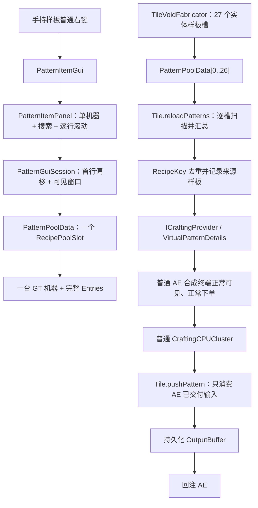

# Void Fabricator 0.3.1 — 27 实体样板槽与单机器样板 UI 设计

| 项目 | 内容 |
| --- | --- |
| 状态 | Accepted；最终需求口径，取代“一张样板内部 27 个机器池” |
| 日期 | 2026-11-16 |
| 数据格式 | `PatternPoolData.ConfigFormat=4`、`PatternView.VIEW_FORMAT=4` |
| 方块 UI | 220×286，9×3 共 27 个实体样板槽 |
| 样板 UI | 325×309，GT 标准机壳，单机器、搜索、13×7 可见图标窗口、逐行滚动、同产物分组 |
| 目标环境 | GTNH 1.7.10 / Java 17，独立 modId `voidfabricator` |
| 可选集成 | AE2-QoL 4.5.0-fix30，运行期反射桥接 |

## 1. 需求与边界

### 1.1 用户最终锁定

1. 27 格位于**虚空合成机方块**中，是 27 张实体机器配方池样板，不是一张样板内部的 27 个机器池。
2. 每张样板只放入一台 GT 机器，识别该机器的完整有效配方池。
3. 手持样板普通右键打开自己的独立 UI，完整移植 TenkeiTech 模板输入总线：325×309 浅色 GT 机壳、13×7 配方图标、电压分行、搜索、滚动、启停、筛选和删除。
4. 流体直接显示流体纹理和数量，不用桶代替。
5. 所有启用的配方必须在普通 AE 合成终端正常可见、正常下单，由普通 AE Crafting CPU 执行；方块 GUI 不是下单入口。
6. 保留黑白名单、点击排除变暗、同产物一行分组、删除/恢复、全部启停、智能倍增、持久化输出缓冲和执行只扣一次料；悬停支持 NEI R/P 查询。
7. 处理样板右键打开后秒关的问题；没有新日志或生命周期证据时，不把猜测写成根因。
8. 用户自行进行 GTNH 实机测试；构建成功不等于游戏内验证通过。

### 1.2 明确不做

- 不做私有 Crafting CPU、自研递归规划器、方块内私有下单或第二套任务账本。
- 不在 `pushPattern` 执行时再次从 ME 扣料。
- 不把 27 张实体样板退化为一张样板中的 27 个隐藏机器池。
- 不同步整台机器的全部图标；只同步当前可见窗口，避免大配方池造成网络包和客户端控件膨胀。
- 不宣称旧“一张样板 27 台机器”的配置能无损迁移到单机器模型。

## 2. 高层架构



## 3. 数据模型

### 3.1 方块 `TileVoidFabricator`

- `ItemStack[27] patterns`：实体样板槽；槽号 0–26，GUI 为 9 列 × 3 行。
- `PatternPoolData[27] patternData`：每个非空样板各自的一份单机器配置。
- `publishedPatterns`：当前发布集合，以 `RecipeKey` 去重。
- `patternOwners`：每个发布配方对应的来源样板集合，用于智能倍增约束。
- `legacyMachine`：旧方块机器在暂时没有兼容样板时的暂存，拆除仍掉落，避免无声丢物。
- `OutputBuffer`：沿用有界、持久化的输出缓冲。

世界 NBT 主结构为 `Patterns`，每项包含 `Slot`。读取保留 `PoolPattern` 和 `Machine` 的旧入口；首个兼容样板可接收旧机器。方块不再提供独立机器槽。

### 3.2 样板 `PatternPoolData`

运行态只保留一个 `RecipePoolSlot`：

| 键 | 语义 |
| --- | --- |
| `ConfigFormat=4` | 当前持久化格式 |
| `Pools` | 只写出一个主池，包含一台 `Machine` 和完整 `Entries` |
| `Filters` / `FilterMode` | 该样板自己的黑白名单，最多 27 个主输出筛选 |
| `Deleted` | 该样板自己的删除 RecipeKey 集合，重扫不补回 |
| `SmartDoubling` / `MaxRounds` | 该样板自己的倍增设置 |
| `Machine` / `Entries` | 主池的旧根节点投影，仅供兼容工具和旧读取路径 |
| `LegacyPools` | 旧 27 池配置的原始备份，不参与运行和发布 |
| `VirtualToken` / `Snapshot` | AE 执行令牌，不属于玩家配置样板 |

`MAX_POOLS=27` 只保留为旧格式读取上限和旧客户端视图兼容常量，不表示运行态还有 27 个池。`MAX_ENTRIES=27` 仅是废弃编辑器兼容别名；可见窗口大小为 13×7=91，不限制完整配方数量。

### 3.3 旧 27 池迁移

1. 读取旧 `Pools[0..26]`，选择第一个可用机器作为主机器。
2. 在根节点保留 `LegacyPools` 原始备份。
3. 主池只保留当前主机器重新扫描可识别的配方，不混入其他机器的条目。
4. 对相同 `RecipeKey` 恢复旧启停状态，随后裁剪为单池并保存一个 `Pools` 项。

这是**有损迁移**：其余 26 台机器的运行配置不会自动拆成 26 张新实体样板。原始数据仍在 `LegacyPools`，但不能宣称完整无损转换。

### 3.4 条目与流体

- `PatternEntry.key`：稳定的 `vf1:` + SHA-256 RecipeKey。
- `globalIndex`：当前单机器完整条目集合中的索引；搜索和滚动后仍用它操作原配方。
- `display`：物品主输出；流体条目不再创建 `Items.bucket`。
- `displayFluid`：真实 `FluidStack` 副本，包含流体身份、数量和 NBT，随条目深拷贝、NBT 与视图同步保存。
- 共享筛选键按主输出：物品 `item:registryName:damage`，流体 `fluid:fluidName`，忽略物品 NBT；不等于完整 RecipeKey。
- `isEntryAllowed = enabled && 未删除 && 未被黑白名单过滤`。

## 4. UI 与同步

### 4.1 方块 220×286

- 顶部：AE 在线状态、已发布数量、在途批次和缓冲类型。
- 中部：9×3 实体样板格；槽组按每行 9 格注册，支持正常槽位交互和 Shift 点击。
- 底部：玩家背包。
- 手持样板普通右键仍打开样板 UI；潜行右键方块放入第一个空样板槽。
- 手持 GT 机器右键方块只提示先放入样板 UI，不写入方块机器槽。

### 4.2 样板 325×309 GT 标准机壳

布局基准为 TenkeiTech `MTEAutoTemplateInputGui`，不改造成深色自绘面板：

- 面板：325×309，`GTGuiThemes.STANDARD`，内容区 x=7、y=6、宽 311、高 217，玩家背包距底 6 px。
- 顶部：18×18 机器槽、机器名、右侧当前电压；下一行是状态、黑白名单、筛选相同、删除、智能倍增和搜索框（x=204，宽 107）。
- 主列表：y=38，7 行 × 13 个 20×20 图标（内部图标 18×18），行高 22，列表高 154；图标 x 从 42 起、步长 20；左侧 40×20 电压按钮（点击整层启停）；右侧 x=302 纵向滑块。
- 底部：y=197，配方计数、x=122 恢复删除、x=144 全部启用、x=216 全部停用、x=288 GT logo；再下方是标准玩家背包。
- 左键启停单条；被黑白名单过滤的条目左键执行对应恢复；用户禁用显示暗色蒙层、红色边框和红色叉号，筛选隐藏使用中性暗色。
- 右键切换相同主输出黑白名单；顶部“筛选相同”开关切换同产物分组视图：同一主输出一行、行内列为该产物的备选，行首显示行号和产物名。
- 黑名单/白名单、同产物分组、智能倍增、最大轮数均为当前样板自己的配置。
- 物品图标使用 `ItemDisplayWidget`；流体图标使用真实 `FluidDrawable`，图标上叠加数量，Tooltip 只显示名称和数量/mB，不使用桶。
- 悬停格支持 NEI `R` 查询真实 GT 配方、`P` 通过自定义 `void_pattern` handler 查询样板输入/输出、电压、持续时间和来源。

### 4.3 有界滚动窗口

`PatternGuiSession` 使用 `requestedRow` 而不是页号：

```text
rowCount = ceil(matchedEntries / 13)
maxRow = max(0, rowCount - 7)
startRow = clamp(requestedRow, 0, maxRow)
可见条目 = searchedEntries[startRow * 13, startRow * 13 + 91)
```

- `DoubleSyncValue` 同步 0–1 的滑块位置；服务端把它换算回首行。
- 每次只同步一个主池摘要、当前最多 91 个 `PatternEntry` 和配置状态。
- 搜索只改变可见匹配集合，不删除未匹配配方；输入新搜索时回到首行。
- 服务端点击映射为 `requestedRow * 13 + localIndex`，再还原原 `globalIndex`，避免搜索或滚动后误操作相邻条目。
- 删除、重扫和配方数量变化后重新钳制首行，避免窗口停在空白尾部。
- 搜索结果先按电压档、再按名称和 RecipeKey 排序，使 13×7 列表按电压分行；左侧电压按钮在新电压档的第一行显示绿色，其余行显示灰色档名，点击可整层启停。

### 4.4 物品 GUI 生命周期

入口使用 `GuiFactories.playerInventory().openFromMainHand()`，服务端从 `PlayerInventoryGuiData.getUsedItemStack()` 取当前样板并构造 `PatternPoolData`。不得在 `buildUI` 中清空主手；MUI2 后续 `getGuiHolder()` 仍需读取该物品。

**写回策略**：MUI 可能把 GUI 绑定到打开时的 `ItemStack` 引用，而不是玩家当前槽里的对象。为此 `PatternPoolData` 增加 `setOnSaved`，每次 `save()` 完成后立即把完整 NBT 深拷贝到 `PlayerInventoryGuiData.getUsedItemStack()` 并调用 `setUsedItemStack`；面板关闭时再 `persistNow()`、`markDirty` 和 `sendContainerToPlayer`。这样“新机器放入后退出被重置”和“拿出机器后机器残留”都由同一写回路径覆盖。

交互校验已移除 `settings.canInteractWith`；当前只校验主手物品仍是有效池样板。“右键秒关”的最终根因和实机关闭路径仍需用户的新日志/复测闭环，旧 AE `selfRep=null` 崩溃报告不是证据。

另外移除空心圆角矩形组合；实例 MUI2 日志明确报告 `Hollow rectangles currently can't have a corner radius`，旧实现会在客户端和服务端持续刷屏。

## 5. AE 发布、倍增与执行

### 5.1 27 张样板汇总发布

`TileVoidFabricator.reloadPatterns`：

1. 逐槽读取实体样板并确保其单机器扫描存在；单槽异常记录并隔离，不直接清空其他槽的发布结果。
2. 应用该样板自己的启停、删除和黑白名单。
3. 用 `LinkedHashMap<String, VirtualPatternDetails>` 按 RecipeKey 去重。
4. `patternOwners` 记录所有来源样板；替换发布集合并安排一次 AE 网格更新。
5. 普通 AE 终端通过原生 Provider 看到并下单；无需打开方块。

### 5.2 智能倍增

继续通过 `ISmartDoublingMedium` 复用 AE2-QoL 对普通 CPU 的调度，不复制其 CPU Mixin：

- `isSmartDoublingEnabled()` 表示方块中是否存在启用倍增的样板。
- `getMaxMultiplier(details)` 找到当前虚拟配方的来源样板集合。
- 任一来源关闭智能倍增时，该配方倍率限制为 1，防止另一张样板把已关闭的重复配方带着倍增。
- 启用时取所有来源中最严格的最大轮数，并同时受输出缓冲剩余批次、堆栈类型容量和硬上限约束。
- 没有 AE2-QoL 时回退普通单轮 Medium，配置保留。

### 5.3 原生下单和只扣一次料

```text
普通 AE 终端可见并下单
  → 普通 CraftingCPUCluster 抽取输入
  → Tile.pushPattern(ic2InventoryCrafting, details)
  → 逐槽验证输入数量
  → canAccept 按智能倍增后的 N 批输出预留容量
  → 清空已交付输入
  → OutputBuffer 登记 N 批输出
  → 回注 AE
```

输入验证或容量失败时不修改 AE 输入槽。已接受任务不受后续禁用回滚；未交付输出持久化并在重连后重试。

## 6. 关键 ADR

### ADR-001：27 张实体样板，而不是单样板 27 池

**决定**：方块保存 27 张样板，每张样板只绑定一台机器。  
**替代**：一张样板内部 27 台机器、方块只放一张总样板。  
**收益**：符合参考图和物品生命周期；每张样板可独立配置、移动和安装。  
**代价**：方块需要逐槽 NBT、发布汇总、来源跟踪和迁移。

### ADR-002：普通 AE Provider/Medium 与普通 CPU

**决定**：不在方块内建立下单或 CPU 体系。  
**收益**：AE 终端、递归规划、取消、CPU 占用和扣料保持原生。  
**代价**：必须遵循 AE 的 Medium 派发与输出时序。

### ADR-003：服务端逐行窗口，而不是全量同步或纯分页

**决定**：13×7 可见窗口 + 行偏移 + 滑块/滚轮，保留逐行滚动，不做整池同步。  
**收益**：交互接近 TenkeiTech，包体和客户端控件数量有界。  
**代价**：所有操作必须正确还原搜索前的 globalIndex，并处理尾部钳制。

### ADR-004：重复 RecipeKey 去重并采用最严格倍增约束

**决定**：重复配方在 AE 只发布一次；任一来源关闭倍增则单轮，轮数取最严格值。  
**收益**：避免终端重复样板和绕过某张样板的关闭设置。  
**代价**：重复来源不能各自在 AE 中呈现独立倍增行为。

## 7. 非功能要求与失败模式

| 类别 | 设计约束 |
| --- | --- |
| 性能 | 单机器完整扫描；只同步 91 个可见条目；发布去重使用哈希映射 |
| 可靠性 | 单槽扫描异常隔离；输入失败不扣料；未交付输出持久化 |
| 安全 | 服务端钳制行/条目索引；输入逐槽验证；机器和样板严格一件 |
| 可维护性 | 扫描、单池数据、滚动会话、UI、AE 发布分层；旧编辑器不进入当前入口 |
| 兼容性 | ConfigFormat 4；保留旧根投影与 LegacyPools；旧方块 Patterns/PoolPattern/Machine 读取 |

| 失败 | 处理 |
| --- | --- |
| 样板未放机器 | 该样板状态 `no_machine`，不发布，不影响其他槽 |
| 机器无有效配方 | 状态 `no_entries`，不发布 |
| 单槽扫描失败 | 记录日志并保留其他槽结果；该槽不贡献新条目 |
| 搜索无结果 | 显示空窗口和 0 行，不清空原配方 |
| 删除/重扫导致行数减少 | 首行重新钳制，不访问旧索引 |
| AE 断网 | 保留输出缓冲，重连后重试 |
| 输出容量不足 | `isBusy` / `canAccept` 提前拒绝并限制倍增 |
| 旧 27 池样板 | 保留 LegacyPools；只迁移主机器可识别配方，明确有损 |

## 8. 验证边界与实测清单

静态构建、语言和资源结果以 `README.md` 的当前构建记录为准。没有启动 GTNH/Prism，没有游戏内通过声明。

用户优先实测：

1. 方块 27 槽放入、取出、Shift 点击、保存重启和拆除掉落。
2. 每张样板只放一台机器；普通右键 UI 不再秒关；新放入机器后关闭/重开保留，取出机器后关闭/重开不再残留；切换主手时按预期关闭。
3. 超过 91 条时逐行滚动、拖动滑块；滚动/搜索后点击、筛选和删除仍命中正确配方。
4. 物品与流体图标、流体数量、Tooltip、排除变暗和黑白名单恢复。
5. 27 张样板在普通 AE 终端的发布汇总、重复去重、正常下单、普通 CPU 只扣一次料和输出回注。
6. 重复来源中一张关闭倍增时确认该配方不倍增；不同最大轮数确认采用最严格值。
7. 断网、缓冲满、保存重启、旧单池样板、旧 27 池样板和旧方块机器迁移。
