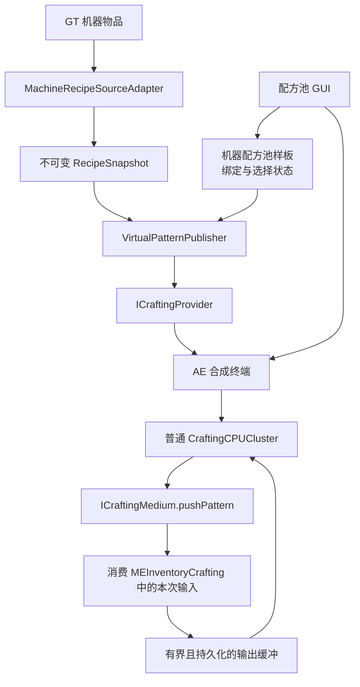

# Void Fabricator 设计说明书

| 项目 | 内容 |
| --- | --- |
| 版本 | 0.3.3（AE 原生合成链 + 无线 EU 供电版） |
| 日期 | 2026-11-16 修订 |
| 状态 | Accepted；作为后续实现的唯一架构基线 |
| 目标环境 | GTNH 1.7.10 / Java 17，独立 modId `voidfabricator` |
| 当前编译基线 | AE2 rv3-beta-1083-GTNH、GT5U 5.09.54.205、MUI2 2.3.92-1.7.10 |

> 本版取代 0.1.x 中“私有 CPU、仅方块 GUI 下单、执行器再次从 ME 扣料”的方案。
> 方块必须让配方在 AE 合成终端中正常显示，并接受玩家从 AE 终端发起的正常合成任务。
>
> 2026-11-16 最终修订：方块内有 9×3 共 27 个**实体样板槽**；每张样板只绑定一台 GT 机器，并在自己的独立 325×309 GT 标准机壳 UI 内扫描和配置该机器的完整配方池。方块汇总 27 张样板的发布集合。
> 2026-11-16 供电修订：AE 接受合成时，按“配方 EU/t × 工作时长 × 工作份数”从方块主人的 GregTech 无线 EU 池一次性原子扣电；余额不足拒绝，输出缓冲失败退款。不要求真实 GT 机器结构、线缆或输入/输出仓。
> 具体数据模型、逐行滚动 UI、流体直显、筛选/删除语义、AE2-QoL 桥接和旧存档迁移见
> `docs/DESIGN_pattern_configuration_center.md`。本文以下章节保留 AE 原生 Provider/Medium 的总基线；
> 旧“方块内单机器单样板面板”与“一张样板 27 池”的细节均已废止。

## 0. 当前边界

本文件描述目标架构，不把设计内容冒充为已经完成的运行时能力。

首个垂直切片只接受以下验收闭环：

1. 放入一个能解析到 `RecipeMap` 的 GT 机器物品；
2. 插入绑定的机器配方池样板；
3. AE 合成终端看到至少一条有效产物；
4. 通过普通 AE 合成 CPU 正常下单；
5. AE 扣除真实原料，Void Fabricator 消费本次派发的输入并交付产物；
6. 输出缓冲、机器物品和样板在保存/加载后不丢失。

当前已实现方块 27 个实体样板槽、样板单机器数据模型、325×309 GT 标准机壳的 13×7 搜索/逐行滚动配方 UI、直接流体纹理与数量、启停/黑白名单/删除恢复、智能倍增、旧存档迁移入口，以及方块主人无线 EU 的余额检查、一次性扣电和失败退款。普通 AE 下单、普通 CPU 执行、输出缓冲与只扣一次料继续遵循本文契约；GTNH 运行时验证由用户执行，不由静态构建代替。

## 1. 需求与非功能要求

### 1.1 功能要求

- 单方块接入 AE 网络；不要求真实 GT 机器结构、线缆、耗电输入仓或输出仓。
- GT 机器只作为配方来源；执行时不运行真实 GT 机器，但按配方 EU/t、时长和工作份数从方块主人的 GT 无线 EU 池扣电。
- 一张机器配方池样板管理整台机器配方的绑定、启停、黑白名单和变体选择。
- 启用的配方以处理型虚拟样板发布给 AE；玩家在 AE 合成终端正常下单。
- 普通 AE 编码样板与虚拟 GT 配方可以出现在同一条递归合成链中。
- 真实输入被消耗，非消耗条件不参与 AE 请求，产物及声明的副产物返回 AE。
- 已实现的控制面板提供机器/样板安装槽、扫描状态、发布/在途/过滤计数、重扫和安全取出；后续目录、筛选、变体与配置页在同一数据模型上扩展。
- GUI 不提供绕过 AE 的私有下单入口；如果未来加入下单按钮，也必须调用 AE 原生 `beginCraftingJob` / `submitJob`。

### 1.2 非功能要求

- **正确性**：已接受的输入不得重复扣除；已消费输入不得再返回拒绝；无线 EU 必须先检查余额再原子扣电，失败不得部分扣除，输出缓冲失败必须退款。
- **持久性**：AE 任务中的虚拟样板在重启后可独立重建；未交付输出写入 TileEntity NBT。
- **性能**：扫描与配置修改在服务器线程完成；发布后的快照不可变，供 AE 规划线程安全读取。
- **可恢复性**：断网时保留输出；重新联网后继续交付。达到缓冲上限时停止接收新任务。
- **兼容性**：只修改本项目，不修改或依赖 AE2-QoL 的源码和 Mixin。
- **可维护性**：AE 负责任务真相，本项目不维护第二套递归规划器和第二套任务账本。

## 2. 关键语义变化

### 2.1 AE 合成 CPU 是必需的

`ICraftingGrid.submitJob` 只接受 `CraftingCPUCluster`。因此：

- 网络必须至少有一个普通 AE 合成 CPU，才能正式提交任务。
- Void Fabricator 不注册新的 CPU，所以不会在 CPU 列表中新增自己的条目。
- 没有可用 CPU 时，配方仍可能显示为可合成，但任务不能进入正常执行阶段。

### 2.2 “瞬间完成”的准确含义

配方没有 GT 工作时长、耗电和机器并行上限，但仍受以下条件限制：

- AE 合成规划耗时；
- AE CPU 每 tick 的 operation budget；
- 输出交接和缓冲区状态；
- 服务器单 tick 工作预算。

不再承诺绝对零 tick、无限任务或无限内存。

### 2.3 AE 终端显示的是可合成产物

`ICraftingProvider` 将配方输出注册为 requestable/craftable。普通 AE 终端按产物显示可合成状态，不会为每个 GT 变体自动创建一张独立的实体样板卡。变体选择由配方池配置和优先级决定。

### 2.4 零真实输入配方

普通 AE 执行链在没有实际输入时不能形成有效的派发上下文。首版不得把这种配方发布为可下单配方；它们在目录中显示为“不支持：缺少真实输入”。

## 3. 总体架构



### 3.1 责任边界

| 组件 | 负责 | 不负责 |
| --- | --- | --- |
| RecipeAdapter | 机器识别、RecipeMap 枚举、配方转换、能力说明 | AE 下单、任务执行 |
| RecipeSnapshot | 冻结输入、输出、来源和语义元数据 | 读取 TileEntity 或世界状态 |
| 机器配方池样板 | 一台机器绑定、完整配方条目、启停、名单与倍增配置 | AE 下单、私有 CPU、第二套任务账本 |
| 虚拟执行令牌 | 让 AE 序列化并重建一条虚拟配方 | 作为第二张玩家配置样板 |
| ICraftingProvider | 发布当前可接单的配方 | 自行提交任务 |
| 普通 AE CPU | 规划、递归、预留原料、任务状态、取消未派发步骤 | 理解 GT 机器条件 |
| ICraftingMedium | 校验并消费本次输入，登记输出 | 再次从 ME 扣料 |
| OutputBuffer | 暂存未交付产物、持久化、重试 | 修改 AE 任务数量 |
| MUI2 控制面板 | 安装/取出、状态与诊断、触发重扫；未来扩展配置与 AE 原生下单 | 建立第二套任务真相或私有 CPU |

## 4. 不可变配方模型

### 4.1 RecipeSnapshot

至少包含：

- 格式版本与稳定 `RecipeKey`；
- 来源 ID（RecipeMap、Adapter、机器语义）；
- 原始物品和流体输入，保留槽位顺序；
- 非消耗/虚拟输入；
- 物品和流体输出及副产物；
- EUt、duration、specialValue；
- 概率输入/输出语义；
- 需要的机器模式或动态 Adapter 参数。

数组在构造时复制，发布后不得修改。`RecipeKey` 使用带版本的 SHA-256 摘要，输入包括：

```text
vf1 + sourceId + 原始槽位与数量 + 完整物品 NBT + 流体身份与数量
    + 非消耗输入 + 输出及完整 NBT + EUt + duration + specialValue
    + 概率语义 + Adapter 版本
```

不使用不稳定的配方枚举序号。完全相同的配方可以去重；具有不同执行语义的配方不得因输入输出相同而被合并。

### 4.2 机器指纹

当前通用绑定使用：

- 物品注册名与物品元数据；
- `IMetaTileEntity` 实现类；
- 后续确有必要的白名单模式字段。

电量、运行状态、所有者、覆盖板和普通运行时 NBT 不参与指纹。动态机器必须由专用 Adapter 扩展身份语义。

### 4.3 两类样板物品

1. **机器配方池样板**：玩家配置载体，只保存绑定和选择状态。
2. **虚拟执行令牌**：`ItemStack` 内含一条不可变 `RecipeSnapshot`，由 `ICraftingPatternItem#getPatternForItem` 独立重建。

AE 保存的是后者，因此重启时不依赖原方块仍在线，也不要求重新枚举 GT RecipeMap 才能解析 NBT。

## 5. GT 配方读取

以当前 5.09.54.205 编译基线为准：

- `gregtech.common.blocks.ItemMachines#getMetaTileEntity(ItemStack)`；
- `RecipeMapWorkable#getAvailableRecipeMaps()` 获取机器支持的配方池；
- `RecipeMapWorkable#getRecipeMap()` 作为当前池入口；
- 非该接口实现通过受控反射尝试 `getAvailableRecipeMaps` / `getRecipeMap`；
- `RecipeMap#getAllRecipes()` 读取配方；
- `RecipeMap#getNonConsumedInputItemIds()` 辅助识别非消耗物品。

通用过滤规则：

- 排除 null、`!mEnabled`、`mFakeRecipe`；
- 排除没有声明输出的配方；
- 首版排除零真实输入配方；
- 概率产物未确定固定结算策略前，不发布为可执行配方；
- 不支持的动态语义记录原因，不静默生成错误样板。

反射只用于读取明确的方法名，不执行任意 NBT 指定的方法。

## 6. AE 原生执行契约

### 6.1 发布

1. 机器或样板变化后在服务器线程重新扫描；
2. 应用启停和名单，生成新的不可变发布快照；
3. `ICraftingProvider#provideCrafting` 只读取该快照；
4. 整批修改完成后发送一次 `MENetworkCraftingPatternChange(this, gridNode)`。

不得在 `provideCrafting` 内再次扫描 GT，也不得在重建过程中递归发布变更事件。

### 6.2 下单与扣料

AE 原生顺序为：

1. 终端计算 `CraftingJob`；
2. 玩家向普通 `CraftingCPUCluster` 提交；
3. CPU 校验输入，并以 `MODULATE` 把本次原料抽入 `MEInventoryCrafting`；
4. CPU 调用匹配 Medium 的 `pushPattern`；
5. 如果全部 Medium 拒绝，AE 回收本次 `craftingInventory`。

Void Fabricator 不得再次从 ME 扣料。

### 6.3 pushPattern

接受前：

- 必须是本模组可解析的 `VirtualPatternDetails`；
- 网格在线且输出缓冲有余量；
- 逐槽核对本次输入的身份和数量；
- 按 `max(0,EUt) × max(0,Duration) × batches` 计算本次无线 EU 成本；
- 成本大于 0 时，方块主人必须存在、`getUserEU` 余额足够，并通过 `addEUToGlobalEnergyMap(owner, -cost)` 原子扣电；
- 任一条件失败时，不修改任何输入槽、不留下部分扣电并返回 `false`。

接受后：

- 把全部输出写入持久化输出缓冲；若缓冲写入抛异常，退回本次扣电并返回 `false`；
- 缓冲写入成功后，才清空本次已交付的输入槽；
- 增加在途批次并标记 TileEntity 脏；
- 返回 `true`；
- 此后不得再返回拒绝或重复消费。

### 6.4 输出时序

AE 在 `pushPattern` 返回成功后才登记本次预期输出。因此不能假设在 `pushPattern` 内注入一定立即完成。

输出缓冲每 tick 在服务器侧尝试：

1. 获取当前 `IStorageGrid`；
2. 以 `MachineSource` 注入聚合后的 `IAEStack`；
3. 只移除被完整接受的部分，剩余量继续保留；
4. 缓冲完全清空后减少/清空在途批次；
5. 断网或部分接受时保留 NBT，后续 tick 重试。

`isBusy()` 在网格不可用或缓冲达到上限时返回 `true`。首版可采用更保守的“缓冲非空即 busy”，后续再测试有界并行。

### 6.5 禁用、取消与拆除

- 禁用/移除样板影响新的规划与派发；已经接受的当前 craft 必须完成。
- 已派发但尚未执行到本 Medium 的后续步骤，可能因样板撤下而暂停，采用 AE 原生语义。
- 玩家取消 AE 任务不表示可以撤销已接受 craft；已接受部分仍交付产物，未派发部分由 AE 取消。
- 输出缓冲非空时禁止普通拆除，或把完整缓冲保存在掉落实体 NBT 中；不得直接清空。

## 7. 配方池与 GUI 目标

### 7.1 已实现的控制面板

`VoidFabricatorGui` 使用 MUI2 通用 TileEntity GUI，面板尺寸 220×300：

- 机器槽（索引 0）和样板槽（索引 1）；槽位通过 `IItemHandlerModifiable` 与 `ModularSlot` 同步；
- 状态区显示已发布样板数、在途批次数/产物类型数、已过滤配方数、当前状态和 AE 网络在线状态；
- “重扫配方”按钮在服务器侧重新扫描当前机器；
- “取出样板”“取出机器”按钮先尝试放入玩家背包，背包满时才在方块旁掉出；
- 玩家背包与 MUI2 槽位交互；
- 空手右键打开面板；手持 GT 机器或机器配方池样板右键会先安装再打开；其他手持物品返回 `false`，不吞掉 AE 线缆、工具或建筑方块的正常使用。

槽位规则：

- 机器槽在样板仍安装时不能取出；必须先取出样板。
- 样板槽在机器未安装时不接受样板。
- 样板首次放入时自动绑定当前机器的指纹与显示名。

### 7.2 后续配置页

后续 GUI 在同一数据模型上提供：

- 配方类型、搜索、电压层、电路、仅多输出产物、仅已启用、仅黑名单；
- 整组、整层批量启停，批量操作只触发一次发布变更；
- 单配方查看真实输入、虚拟输入、输出、EUt、duration、来源与不支持原因；
- 同一产物多变体选择与优先级；
- 发布数量、在途批次、输出缓冲和最后一次错误；
- 可选下单按钮调用 `beginCraftingJob` / `submitJob`，不进入私有执行器。

配置交互在服务器侧完成，不能依赖客户端 RecipeMap 状态。

## 8. 安全、性能与故障预算

- 所有来自 NBT 的长度、数量和数组大小必须设上限，禁止直接分配无界集合。
- 不把 long 数量无检查地压缩为 int；AE 层使用 `IAEStack` 数量。
- 不发布来源不明或无法稳定序列化的配方。
- 输出缓冲设置批次和堆栈数上限，防止无限增长。
- 批量发布时按产物建立索引，避免每个请求重复扫描整池。
- 记录扫描、发布、接受、交付、拒绝和异常日志；异常不得被空 catch 吞掉。
- 普通 AE 合成规划本身可能很大，应设置测试结果和警告，不用 Mixin 隐藏问题。

## 9. 关键 ADR

### ADR-001：使用普通 AE CPU 和 Provider/Medium

- **状态**：Accepted。
- **背景**：用户要求 AE 终端正常看到配方并下单；原生 `submitJob` 需要 CPUCluster。
- **决定**：方块提供样板并作为 Medium，复用普通 AE CPU。
- **优点**：原生终端、递归、普通样板互操作、任务持久化，代码量更小。
- **代价**：需要普通 AE CPU，吞吐受 AE 调度约束。
- **备选**：隐藏私有 CPUCluster；因兼容性和终端隐藏成本高而拒绝。

### ADR-002：配置样板与执行令牌分离

- **状态**：Accepted。
- **背景**：整池配置要精简，但 AE 任务必须能独立恢复。
- **决定**：配置样板存选择，内部执行令牌存单条不可变快照。
- **优点**：兼顾一张整池样板和 AE 原生序列化。
- **代价**：执行令牌 NBT 大于纯 RecipeKey，需要版本与大小控制。

### ADR-003：消费 AE 已交付输入，不再次扣料

- **状态**：Accepted。
- **背景**：CPU 在 `pushPattern` 前已以 MODULATE 抽取本次输入。
- **决定**：逐槽验证后消费 `MEInventoryCrafting`。
- **优点**：避免重复扣料，并保留 AE 拒绝后的回收路径。
- **代价**：必须严格遵守接受后不能拒绝的状态机。

### ADR-004：输出缓冲持久化

- **状态**：Accepted。
- **背景**：CPU 在 Medium 接受后才登记预期输出，且断网/取消可能造成部分交付。
- **决定**：有界缓冲写入 TileEntity NBT，联网后重试。
- **优点**：避免吞产物和同步时序假设。
- **代价**：需要拆除保护、容量控制和恢复测试。

### ADR-005：删除自研递归规划器

- **状态**：Accepted。
- **背景**：AE 原生规划已支持虚拟样板与普通样板混合递归。
- **决定**：目标产物任务统一走 AE；GUI 只展示和提交。
- **优点**：消除双任务真相和大量边界代码。
- **备选**：保留私有规划器；仅在以后存在无法由 AE 表达的需求时另行 ADR。

### ADR-006：使用方块主人的 GT 无线 EU 池按配方扣电

- **状态**：Accepted。
- **背景**：用户要求按配方实际功率和工作时长、工作份数，在工作前检查无线电网余额，足够则一次性扣电完成合成。
- **决定**：方块放置时绑定主人；`pushPattern` 在消费 AE 输入前，按 `EU/t × Duration × batches` 调用 `WirelessNetworkManager` 做余额检查和原子扣电；输出缓冲失败退款；零成本配方不要求主人。
- **优点**：与 GT 无线输出仓/输入仓共用玩家/团队池；一次扣电、无部分扣电，AE 输入仍只扣一次。
- **代价**：旧无主方块首次调度会被拒绝，必须先由玩家打开一次；超频、并行和 tier 差异未重新模拟，只用基础快照。
- **备选**：每 tick 持续扣电、或使用 AE 网络电力；前者与一次性完成语义不符，后者不是用户指定的 GT 无线电网。

## 10. 实施顺序

| 阶段 | 内容 | 验收 |
| --- | --- | --- |
| M0 | 设计重构、编译 API 核验 | 本文与依赖基线一致 |
| M1 | RecipeSnapshot、RecipeKey、GT 扫描、两类样板 NBT | 扫描可重复，NBT 往返一致 |
| M2 | Provider/Medium、方块注册、输出缓冲、基础交互 | 单条物品配方从 AE 下单成功 |
| M3 | 流体、多输出、断网、取消、重启和拆除测试 | 无复制、无吞料、可恢复 |
| M4 | 完整配方池配置；基础 MUI2 控制面板已完成 | 面板可打开、槽位/按钮/状态同步正常；批量筛选和变体配置正确发布 |
| M5 | 动态机器 Adapter、完整 GTNH 验证和性能调优 | 目标包运行与压力测试通过 |

## 11. 必须通过的测试

- [ ] AE 终端能看到可合成产物并用普通 CPU 下单。
- [ ] 输入只扣一次；拒绝 Medium 时输入槽未改变。
- [ ] 非消耗物不进入真实 AE 输入。
- [ ] 多物品/流体输出数量一致，部分注入后剩余量正确。
- [ ] 保存并重启后虚拟样板和输出缓冲可恢复。
- [ ] 断网不丢输出，重连后继续。
- [ ] 取消不会复制输入；已接受 craft 的产物不丢失。
- [ ] 缓冲非空时不能通过拆除销毁产物。
- [ ] 配方枚举顺序变化不改变 RecipeKey。
- [ ] 批量配置只发布一次变更，客户端无 GT 服务端类污染。
- [ ] 零真实输入、fake、禁用、概率语义未决配方不会错误发布。
- [ ] 无线 EU 余额不足时拒绝且输入槽不变、电量不变；余额足够时只扣一笔，倍率合成按份数扣电。
- [ ] 无主方块首次调度被 `no_owner` 拒绝，打开方块绑定后恢复；团队池按 leader 结算。
- [ ] 输出缓冲写入异常时已扣 EU 退回。
- [ ] 完整 GTNH 服务端与客户端实测，而不只是编译通过。

## 12. 视觉与提示文本实现

### 12.1 纹理规格

- 方块：`assets/voidfabricator/textures/blocks/void_fabricator.png`，32×32 RGBA，全不透明。
- 样板：`assets/voidfabricator/textures/items/machine_recipe_pool_pattern.png`，32×32 RGBA，保留透明背景。
- 视觉：深色钛金属机壳、青色 AE 线路、淡紫合成核心；样板使用浅色切角编码卡、配方矩阵、处理器和接触焊点。
- 纹理为原创确定性像素图，不复制 AE2 或 AE2-QoL 资源。
- 放大预览：`docs/ae-texture-preview.png`。
- 可重复生成：`python tools/generate_ae_textures.py`，只使用 Python 标准库。

### 12.2 Tooltips

- `ItemBlockVoidFabricator` 说明 AE 终端下单、普通 CPU 要求、不注册私有 CPU、输入消费、输出缓冲、速度边界、安装/取回和拆除保护。
- 配置样板显示绑定状态与机器显示名，并说明安装、取回、虚拟输入和当前过滤规则；高级提示显示完整机器指纹。
- 内部执行令牌显示来源、RecipeKey 和用途警告；高级提示显示输入/虚拟输入/输出数量及 EUt、duration、specialValue。
- 所有文本位于 `zh_CN.lang` 和 `en_US.lang`，不在 Java 中硬编码玩家可见语言。
- 新绑定时写入 `MachineName`；旧绑定缺少显示名时使用本地化回退文本，不影响指纹匹配。

### 12.3 资源验收

`python tools/validate_assets.py` 校验 PNG 尺寸、RGBA、透明通道、CRC、双语言 Tooltip 键和 jar 条目。当前静态验收结果为 33/33 中文 Tooltip 键、33/33 英文 Tooltip 键，jar 中纹理与源 PNG 逐字节一致。游戏内图集加载与实际 Tooltip 渲染仍属于 GTNH 运行时验收。
